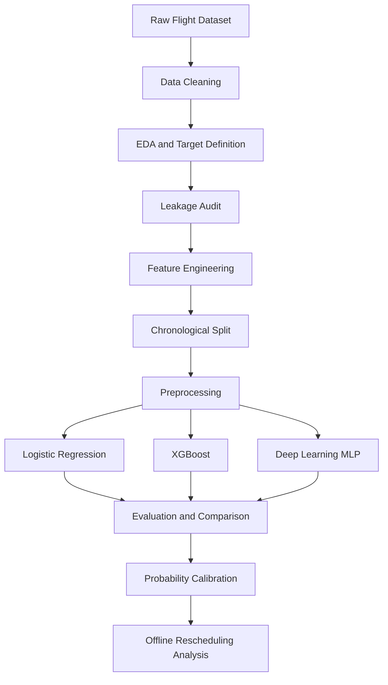

# ✈️ Flight-Club
### Flight Delay Prediction and Rescheduling Using Gradient Boosting and Temporal Deep Learning

<p align="center">
  
  
  
  
  
</p>

## 📌 Project Overview

Flight delays are a major challenge for airlines, airports, and passengers. They can disrupt travel plans, increase operational costs, affect connecting flights, and create congestion across airport networks.

**Flight-Club** is a machine learning and deep learning project that predicts whether a flight is likely to arrive substantially later than its scheduled arrival time. It uses information available before departure, including scheduled times, airline, route, distance, calendar patterns, and historical delay behaviour.

The project combines traditional machine learning with deep learning to investigate whether learned representations of airlines and airports can capture patterns that manually engineered features may miss.

Beyond prediction, the project explores an **offline, what-if rescheduling recommendation framework** to investigate how delay-risk predictions could inform operational decisions under explicit assumptions.

> **Core principle:** Every prediction must use only information available at the chosen pre-departure decision time. Actual departure and arrival outcomes must not leak into the model inputs.

---

## 🎯 Project Objectives

- Understand and clean historical flight data.
- Perform exploratory data analysis (EDA) to understand delay patterns and define the prediction target.
- Conduct a leakage audit to identify variables unavailable at prediction time.
- Engineer temporal, route-based, operational, and historical delay features.
- Preserve chronological ordering during training, validation, and testing.
- Establish a Logistic Regression baseline.
- Train an XGBoost classifier to capture nonlinear relationships and feature interactions.
- Develop a compact deep learning model using an MLP and learned embeddings for categorical variables.
- Compare models using discrimination, operational recall, and probability calibration metrics.
- Explore offline rescheduling recommendations using predicted delay risks and clearly defined operational assumptions.

---

## 🧠 Problem Statement

Given a flight's pre-departure information, predict whether its actual arrival will be more than 15 minutes later than its scheduled arrival.

This is formulated as a **binary classification problem**.

Let \(A_i\) denote the actual arrival time and \(S_i\) the scheduled arrival time for flight \(i\). The arrival delay is:

\[
\text{Arrival Delay}_i = A_i - S_i
\]

The target variable is defined as:

\[
y_i =
\begin{cases}
1, & \text{if Arrival Delay}_i > 15 \text{ minutes}\\
0, & \text{otherwise}
\end{cases}
\]

The model estimates:

\[
P(y_i=1 \mid X_i)
\]

where \(X_i\) contains only features available at the selected prediction time.

The target is derived from actual arrival outcomes, but those outcomes are **never used as predictive features**.

---

## 📂 Dataset

**Starter dataset:** [Flights — Kaggle (2013 US flight records)](https://www.kaggle.com/datasets/)

The project uses historical US domestic flight records from 2013. The dataset contains flight schedules, airline and airport identifiers, route information, distance, and recorded departure and arrival outcomes.

The original data supports both exploratory analysis and the creation of a supervised learning target.

### Dataset characteristics

| Attribute | Description |
|---|---|
| Time period | January–December 2013 |
| Geography | United States |
| Prediction task | Binary arrival-delay classification |
| Target | `delayed` |
| Positive class | Arrival delay greater than 15 minutes |
| Main categorical variables | Carrier, origin, destination, route |
| Main numerical variables | Distance, temporal encodings, historical statistics |
| Prediction timing | Before departure |

The cleaned dataset used in the feature engineering stage contains **327,346 flight records**.

### Dataset storage

Large CSV files may exceed GitHub's web-upload size limit. Therefore, the dataset can be stored in Google Drive, with an access link maintained here.

- **Original dataset:** [Add dataset link]
- **Cleaned dataset:** [Add cleaned dataset link]
- **Feature-engineered dataset:** [Add Google Drive link]

Access permissions should be configured so that authorised project collaborators can retrieve the files.

---

## ⚙️ Project Workflow

The project follows a structured pipeline from data preparation to operational analysis.



### Stage 1: Data Cleaning

The raw flight dataset is inspected and cleaned before analysis.

Key activities include:

- Examining dataset structure, column types, and missing values.
- Identifying incomplete or invalid records.
- Checking duplicate records and data consistency.
- Preparing the date and time fields for chronological analysis.
- Preserving the information needed to define the target and evaluate predictions.

**Output:** A cleaned dataset suitable for EDA and downstream feature engineering.

### Stage 2: Exploratory Data Analysis and Target Definition

EDA investigates the distribution of delays and the relationship between flight characteristics and delay outcomes.

The analysis focuses on:

- Overall delayed versus non-delayed flight distribution.
- Delay patterns across airlines and airports.
- Temporal patterns by month, weekday, and scheduled departure time.
- Route and distance characteristics.
- Missing values, data distributions, and relevant correlations.

The target is defined as `delayed = 1` when arrival delay exceeds 15 minutes and `delayed = 0` otherwise.

**Output:** An understanding of the dataset, target distribution, and potentially useful predictors.

### Stage 3: Leakage Audit and Feature Engineering

This stage ensures that the model only uses information available at prediction time.

#### Leakage prevention

The following actual-outcome fields are excluded from model predictors:

| Variable | Reason for exclusion |
|---|---|
| `dep_time` | Actual departure time |
| `dep_delay` | Actual departure delay |
| `arr_time` | Actual arrival time |
| `arr_delay` | Used to construct the target |
| `air_time` | Actual flight duration |
| `id` | Identifier rather than a meaningful predictor |
| `name` | Redundant carrier description |

Other fields are evaluated according to their availability at the chosen prediction time. In particular, aircraft assignments and flight identifiers are considered separately rather than automatically treated as useful predictors.

#### Temporal features

Cyclic transformations represent recurring time patterns.

For a variable \(x\) with period \(T\):

\[
x_{\sin}=\sin\left(\frac{2\pi x}{T}\right)
\]

\[
x_{\cos}=\cos\left(\frac{2\pi x}{T}\right)
\]

These transformations are applied to appropriate scheduled-time and calendar variables so that values near a cycle boundary are represented as close together.

#### Route features

The feature set includes airline, origin airport, destination airport, route, and distance.

The combined route identifier represents a particular origin-destination pair and allows the model to distinguish between routes that may have different delay patterns.

#### Historical delay features

Historical features summarise delay behaviour using previously observed flights.

Examples include:

- Previous seven-day origin airport delay rate.
- Previous seven-day carrier delay rate.
- Previous seven-day destination airport delay rate.
- Previous seven-day route delay rate.
- Corresponding historical flight counts.

Historical calculations exclude the current date and use only the preceding seven calendar dates. When historical observations are unavailable, the rate is represented as zero alongside a zero observation count.

These variables are historical delay proxies, not direct measurements of real-time airport congestion.

**Output:** A leakage-audited dataset, feature dictionary, audit report, and recommended predictor list.

### Stage 4: Chronological Splitting and Preprocessing

Random splitting can allow information from later dates to influence evaluation on earlier dates. Therefore, this project uses a chronological split.

The current cleaned dataset has the following split labels:

| Split | Period | Number of flights |
|---|---|---:|
| Training | January–August 2013 | 217,727 |
| Validation | September–October 2013 | 55,628 |
| Testing | November–December 2013 | 53,991 |
| **Total** | **January–December 2013** | **327,346** |

The split labels are preserved through feature engineering.

Preprocessing is fitted using the training data only. Validation data supports model selection and threshold decisions, while test data is reserved for final evaluation.

Categorical variables require appropriate encoding. Depending on the model, this may involve one-hot encoding or integer-index representations for learned embeddings. Numerical variables may be scaled where required.

Historical features must also be constructed without future information crossing the chronological boundaries.

**Output:** Consistent training, validation, and testing datasets ready for modelling.

### Stage 5: Logistic Regression Baseline

Logistic Regression provides a simple, interpretable baseline for binary classification.

It estimates the probability of a flight being delayed using a logistic function:

\[
P(y=1\mid X)=\frac{1}{1+e^{-z}}
\]

where \(z\) is a linear combination of the input features and learned coefficients.

This baseline establishes a reference point against which more complex models can be evaluated.

**Output:** Baseline predictions, evaluation metrics, and an interpretable reference for subsequent models.

### Stage 6: XGBoost Classifier

XGBoost is a gradient-boosted decision-tree algorithm that builds an ensemble of trees sequentially.

Each additional tree improves the ensemble by optimising an objective function that combines predictive loss and regularisation.

XGBoost can capture:

- Nonlinear relationships between features.
- Interactions between airline, route, and scheduled time.
- Threshold effects in distance and historical delay patterns.
- Complex relationships that a linear baseline may not capture.

Feature importance can help identify which variables contribute to the model's predictions, although importance should not be interpreted as causal evidence.

**Output:** An enhanced tabular prediction model and a comparison against the baseline.

### Stage 7: Deep Learning Model

The deep learning component investigates whether learned representations of categorical variables improve prediction.

The planned architecture is a compact **multilayer perceptron (MLP) with learned embeddings** for categorical features such as airline, origin airport, and destination airport.

A typical pipeline is:

1. Convert categorical values into integer indices.
2. Map the indices to trainable embedding vectors.
3. Combine the embeddings with numerical features.
4. Pass the combined representation through fully connected layers.
5. Produce a probability of substantial arrival delay.

A temporal model is an optional extension. If implemented, flight histories must be ordered correctly and must use only information available before each prediction.

**Output:** A deep learning model that can be compared with the traditional machine learning approaches.

---

## 📊 Evaluation Strategy

Model evaluation considers both the quality of predictions and their usefulness for operational decision-making.

Because delayed flights may not be evenly distributed across the dataset, accuracy alone is insufficient.

### Evaluation metrics

| Metric | Purpose |
|---|---|
| Precision | Measures how many predicted delayed flights are actually delayed |
| Recall | Measures how many actually delayed flights are identified |
| F1-score | Harmonic mean of precision and recall |
| ROC AUC | Measures discrimination across classification thresholds |
| PR AUC | Evaluates precision-recall performance, particularly useful for imbalanced targets |
| Calibration | Measures whether predicted probabilities correspond to observed event frequencies |
| Recall at selected precision | Measures the proportion of delayed flights detected at a chosen operational precision requirement |

### Fair model comparison

All models should use:

- The same target definition.
- The same chronological evaluation periods.
- Consistent prediction-time assumptions.
- No post-departure predictor leakage.
- Thresholds selected using validation data rather than the final test set.

Where appropriate, probability calibration is fitted using training or validation data without using test outcomes for model selection.

The final comparison should include Logistic Regression, XGBoost, and the deep learning model if it has been implemented.

### Results table

Populate this table after the final evaluation has been completed.

| Model | PR AUC | ROC AUC | Recall at selected precision | Calibration |
|---|---:|---:|---:|---|
| Logistic Regression | TBD | TBD | TBD | TBD |
| XGBoost | TBD | TBD | TBD | TBD |
| MLP with embeddings | TBD | TBD | TBD | TBD |

*Final test results will be added after all models have been evaluated using the agreed methodology.*

---

## 🔄 Offline Rescheduling Recommendation

The final stage explores how predicted delay probabilities could support operational decisions.

The purpose is not to claim that the model can automatically optimise real airline operations. Instead, the project uses an offline, what-if analysis to investigate how risk predictions could inform hypothetical rescheduling decisions.

### Proposed approach

1. Obtain predicted delay probabilities for eligible flights.
2. Define explicit operational assumptions and constraints.
3. Identify hypothetical rescheduling candidates using the predicted risk.
4. Apply a transparent recommendation rule to compare the original and proposed schedules.
5. Evaluate potential changes in predicted delay risk and operational outcomes.

### Possible constraints

- Minimum turnaround time between flights using the same aircraft.
- Airport or route capacity assumptions.
- Feasible departure and arrival time windows.
- Preservation of chronological and operational consistency.
- Restrictions on the number or extent of proposed schedule changes.

Any constraint used in the analysis must be documented and supported by available data or an explicit modelling assumption.

### What-if evaluation

The analysis should distinguish between:

- Predicted changes in delay risk.
- Hypothetical schedule changes.
- Assumed operational costs or penalties.
- Limitations arising from the absence of a real airline scheduling simulator.

A recommendation is not proof that an actual delay would have been prevented. Real-world rescheduling would require additional operational data, feasibility checks, and validation.

**Output:** An offline rescheduling analysis with explicit assumptions and transparent recommendations.

---

## 🛠️ Technology Stack

| Technology | Purpose |
|---|---|
| Python | Core programming language |
| Pandas / NumPy | Data cleaning, manipulation, and feature engineering |
| Matplotlib | Data visualisation |
| Scikit-learn | Logistic Regression, preprocessing, and evaluation |
| XGBoost | Gradient-boosted tree classifier |
| PyTorch | Deep learning and learned embeddings |
| Google Colab / Jupyter | Notebook-based development |
| GitHub | Version control and project collaboration |
| Google Drive | Storage and sharing of large dataset files |

---

## 📁 Repository Structure

The repository is organised by project stage so that the workflow is easy to follow and reproduce.

```text
Flight-Club/
│
├── README.md
│
├── 01_Data_Understanding/
│   └── Dataset documentation and data dictionary
│
├── 02_EDA_Target/
│   └── 02_EDA_target.ipynb
│
├── 03_Feature_Engineering/
│   ├── 03_Leakage_Audit_Feature_Engineering.ipynb
│   ├── 03_leakage_audit.csv
│   ├── 03_feature_dictionary.csv
│   ├── 03_model_features.csv
│   └── Dataset link or download instructions
│
├── 04_Preprocessing/
│   └── Chronological split and preprocessing notebook
│
├── 05_Logistic_Regression/
│   └── Baseline modelling notebook
│
├── 06_XGBoost_Deep_Learning/
│   └── XGBoost and deep learning notebooks
│
├── 07_Evaluation_Rescheduling/
│   └── Model comparison and offline rescheduling analysis
│
└── reports/
    └── Final report and visualisations
```

*This structure describes the intended organisation. Folder and file names should be updated to match the actual repository contents as each stage is completed.*

---

## 🚀 Getting Started

### 1. Clone the repository

```bash
git clone https://github.com/suhanigupta786/Flight-Club.git
cd Flight-Club
```

### 2. Set up the Python environment

Python 3.x is required. A virtual environment is recommended for local development.

```bash
python3 -m venv .venv
source .venv/bin/activate
```

### 3. Install the required libraries

```bash
pip install pandas numpy matplotlib scikit-learn xgboost torch jupyter
```

### 4. Obtain the dataset

Download the required CSV files from the dataset links documented in this repository or access the shared Google Drive files.

Place the files in the expected locations and update notebook paths if necessary.

### 5. Run the notebooks in order

Start with data understanding and EDA, followed by leakage auditing, feature engineering, chronological preprocessing, model training, evaluation, and rescheduling analysis.

Ensure that the final dataset and split labels are consistent across the modelling notebooks.

---

## 👥 Team Contributions

This project is developed collaboratively, with each member responsible for a specific stage.

| Task | Team member | Responsibility |
|---|---|---|
| 01 | Suhani Gupta | Dataset understanding and data dictionary |
| 02 | Khushi | Exploratory data analysis and target definition |
| 03 | Suhani Gupta | Leakage audit and feature engineering |
| 04 | Khyati | Chronological split and preprocessing |
| 05 | Akshat | Logistic Regression baseline |
| 06 | Agrima | XGBoost classifier |
| 07 | Agrima | Model evaluation, comparison, and final analysis |

The team coordinates feature definitions, target construction, chronological splits, and evaluation assumptions to ensure consistency across the pipeline.

---

## ⚠️ Limitations and Considerations

- The starter dataset covers flights from 2013, so its patterns may not represent current airline operations.
- Historical delay rates are proxies for prior delay behaviour, not direct measurements of real-time airport congestion.
- The prediction is only valid under the specified pre-departure information assumptions.
- The quality of historical features depends on correct chronological ordering and the absence of future information.
- Performance metrics depend on the selected target definition, evaluation period, and operational precision threshold.
- Model calibration does not guarantee that predicted probabilities will remain reliable under distribution shifts.
- Offline rescheduling recommendations depend on the assumptions and constraints used in the analysis.
- Correlation and feature importance do not establish causal relationships.

---

## 🔮 Future Improvements

Potential extensions include:

- Incorporating official Bureau of Transportation Statistics on-time performance data.
- Adding richer historical airport traffic and operational congestion features.
- Evaluating generalisation across different years.
- Testing additional categorical embeddings and temporal architectures.
- Investigating calibration methods for improved probability reliability.
- Incorporating weather and other external information, provided it is available at prediction time.
- Developing more realistic rescheduling constraints and evaluating recommendations using richer operational data.

---

## 📚 References

1. Kaggle — [Flights Dataset](https://www.kaggle.com/datasets/)
2. U.S. Bureau of Transportation Statistics — [Airline On-Time Performance Data](https://www.transtats.bts.gov/ONTIME/)
3. Guo, C., Pleiss, G., Sun, Y., & Weinberger, K. Q. (2017). *On Calibration of Modern Neural Networks*. Proceedings of the 34th International Conference on Machine Learning (ICML).

---

## 📌 Project Status

**Project:** Flight Delay Prediction and Rescheduling  
**Approach:** Traditional Machine Learning + Deep Learning  
**Current focus:** Leakage-safe feature engineering, chronological evaluation, and operationally meaningful prediction.

Final performance metrics, calibration results, and offline rescheduling findings will be documented once the complete modelling and evaluation pipeline has been executed.

---

<p align="center">
  <b>Flight-Club</b><br>
  Predicting flight delay risk through data-driven modelling and exploring smarter scheduling decisions.
</p>
